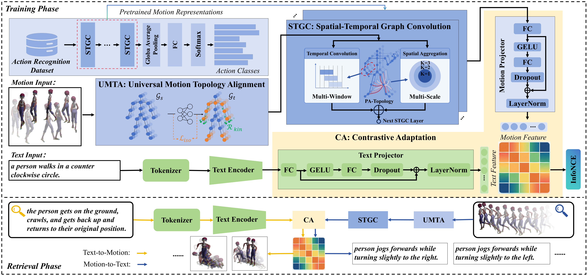
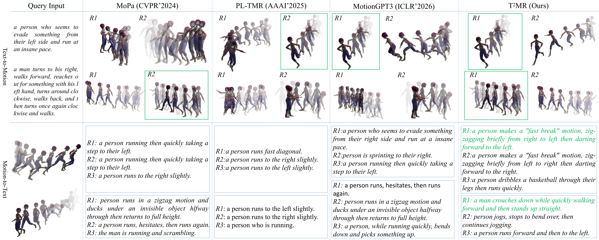

<div align="center">
  <h1>T²MR: Text–Motion Retrieval by Transferring Motion Representations from Action Recognition</h1>
  <p><b>Leyuan~Liu, Hao~Liu, Guoqi~Wang, Yuanqi~Gao, Yuanyuan~Liu, Jingying~Chen</b></p>
</div>

Text–motion retrieval (TMR) aims to establish semantic alignment between textual descriptions and 3D human motion sequences. Despite recent progress, its development is fundamentally constrained by the asymmetric maturity of text and motion representations: text models benefit from massive corpora and foundation models, whereas motion representations remain underexplored due to limited data scale and complex spatiotemporal structure.

To alleviate this asymmetry, we propose T²MR, a transfer-based framework that leverages motion representations learned from large-scale action recognition data to enhance motion representation learning for TMR. Concretely, we design the TMR motion encoder and the action recognition backbone to share an isomorphic spatiotemporal graph convolution architecture, which enables effective reuse of pre-trained motion representations. To further address cross-topology and cross-task discrepancies, we introduce topology alignment and contrastive adaptation mechanisms, facilitating robust cross-modal and cross-task representation alignment.

Extensive experiments on two representative benchmarks, HumanML3D and KIT-ML, demonstrate that T²MR outperforms existing state-of-the-art methods, with particularly strong improvements in retrieving fine-grained motion semantics and long-term motion sequences.

## Method overview



## Comparison figure



## Repository structure

```
T²MR
├── conf/                    # Hydra configs
│   ├── config.yaml          # training config
│   ├── test_config.yaml     # evaluation config
│   ├── dataset/             # HumanML3D.yaml, KIT-ML.yaml
│   └── model/               # roberta.yaml, distilbert.yaml
├── datasets/                # text-motion dataset (NTU 25-joint format)
├── graph/                   # skeleton graphs (NTU RGB+D 25 joints)
├── models/                  # motion encoder and CLIP-style retrieval model
├── scripts/
│   ├── train.py             # training pipeline
│   └── test.py              # evaluation pipeline
├── tools/
├── weights/
│   └── ntu120-xsub-joint.pt # pre-trained NTU120 skeleton weights
├── requirements.txt
└── README.md
```

## Requirements

- Python 3.10
- PyTorch 2.0.1+ (with CUDA)
- Other dependencies:

```bash
pip install -r requirements.txt
```

## Data preparation

Download the original datasets from their official repositories and place them under `data/` so that the layout below is satisfied:

- HumanML3D: https://github.com/EricGuo5513/HumanML3D
- KIT-ML: follow the KIT-ML section of the HumanML3D repository

```
data/
├── HumanML3D/
│   ├── new_joints_ntu25/   
│   ├── texts/                   
│   ├── train.txt / val.txt / test.txt
│   └── Mean_ntu.npy / Std_ntu.npy   
└── KIT-ML/
    ├── new_joints_ntu25/
    ├── texts/
    ├── train.txt / val.txt / test.txt
    └── Mean_ntu.npy / Std_ntu.npy
```

To make raw motion sequences compatible with the T²MR backbone, we use the UMTA-based alignment pipeline to retarget the original HumanML3D / KIT-ML motions into the NTU RGB+D 25-joint topology used by the model. 

```bash
python tools/smpl_to_ntu_converter.py
```

After conversion, the processed sequences are saved as `.npy` arrays with shape `(T, 25, 3)` in the corresponding `new_joints_ntu25` directories, and the data root can be redirected with `dataset.data_root=...` or by editing the config files under `conf/dataset/*.yaml`.

- **Text encoders** are downloaded automatically by `transformers` from the
  HuggingFace Hub:
  - RoBERTa-large: https://huggingface.co/roberta-large (1024-d)
  - DistilBERT-base-uncased: https://huggingface.co/distilbert-base-uncased (768-d)

  For offline machines, download a model manually and pass its local path:

  ```bash
  python scripts/train.py model.text_encoder=/path/to/roberta-large
  ```

## Training

Main setting (HumanML3D + RoBERTa-large, 32 batch size, 200 epochs):

```bash
python scripts/train.py exp_name=t2mr_humanml3d
```

KIT-ML + DistilBERT:

```bash
python scripts/train.py dataset=KIT-ML model=distilbert \
    exp_name=t2mr_kitml train.batch_size=16
```

Training writes `best_model.pt`, `last_model.pt`, the log, and the resolved
config to `checkpoints/<exp_name>/<dataset_name>/`.

Key hyper-parameters (`conf/config.yaml`):

| Setting | Value |
| --- | --- |
| optimizer | Adam |
| learning rate (motion / text / heads) | 1e-5 (motion and heads are scaled by `*_lr_factor` in `conf/dataset/*.yaml`) |
| batch size | 32 (HumanML3D), 16 (KIT-ML) |
| epochs | 200 |
| seed | 42 |
| dropout | 0.5 (HumanML3D), 0.0 (KIT-ML) |

Useful overrides:

```bash
# freeze one of the encoders
python scripts/train.py train.train_text_encoder=false
python scripts/train.py train.train_motion_encoder=false

# train the motion encoder from scratch (without pre-trained skeleton initialization)
python scripts/train.py train.motion_encoder_pretrained=false

# switch the text encoder
python scripts/train.py model=distilbert
python scripts/train.py model=roberta
```

## Evaluation

Retrieval evaluation (Text-to-Motion and Motion-to-Text, R@1/2/3/5/10 and median rank):

```bash
# HumanML3D
python scripts/test.py exp_name=t2mr_humanml3d

# KIT-ML
python scripts/test.py dataset=KIT-ML model=distilbert exp_name=t2mr_kitml

# or point directly to a checkpoint directory
python scripts/test.py checkpoints_dir=./checkpoints/t2mr_humanml3d/HumanML3D
```

Options:

```bash
# evaluate last_model.pt instead of best_model.pt
python scripts/test.py exp_name=t2mr_humanml3d eval.use_best_model=false

# additionally apply Fast Re-ranking to the similarity matrix
python scripts/test.py exp_name=t2mr_humanml3d eval.fast_reranking.enabled=true

# evaluate on the training split
python scripts/test.py exp_name=t2mr_humanml3d eval.eval_train=true
```

## License

The code is released under the [CC BY-NC 4.0](LICENSE) license. See
[NOTICE.txt](NOTICE.txt) for third-party software notices.
